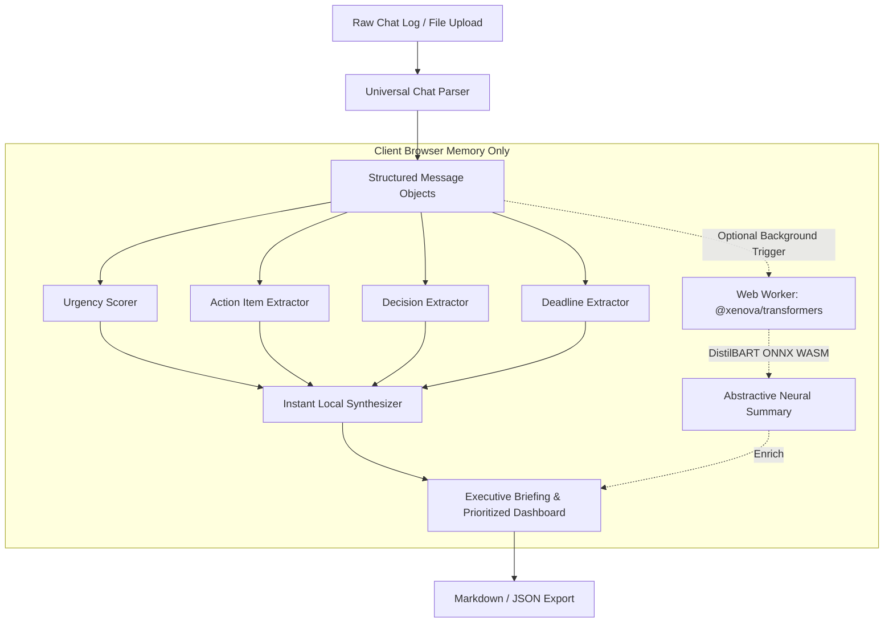

# ⚡ What Did I Miss?
> **Autonomous In-Browser Chat Briefing & Prioritization Engine**  
> *Submission for the **ProtocolX Hackathon***  
> **Author:** **PRANAAM** (`@PRANAAM`)

[](LICENSE)
[](https://nextjs.org/)
[](https://github.com/xenova/transformers.js)
[](#)

---

## 📌 Project Objective & Problem Statement

In modern collaborative environments, users are inundated with hundreds of unread messages across WhatsApp groups, Slack channels, Discord servers, and Microsoft Teams threads. Critical production incidents, urgent deadlines, and direct assignments get buried under chatter, memes, and routine discussion.

**"What Did I Miss?"** is a local-first AI micro-app engineered to solve the unread problem autonomously. It triages raw conversation transcripts in real-time, extracts key decisions, isolates action items with their assignees, flags deadlines, and computes multi-factor urgency scores—all directly on the user's device without a single byte leaving the browser.

---

## 🚀 Key Features

- **🛡️ Strict 100% Local-First AI Architecture:**
  - Conversations, chat logs, and extracted summaries never leave the client's browser.
  - No external cloud AI APIs (zero reliance on OpenAI, Anthropic, or proprietary cloud endpoints).
  - WebAssembly (WASM) and ONNX Runtime Web execution via `@xenova/transformers`.
- **💬 Universal Multi-Format Chat Log Parser:**
  - Robust parsing support for **WhatsApp export format** (both standard dash and bracketed timestamps).
  - **Slack channel transcripts**, **Discord messages**, **Microsoft Teams**, and unstructured text.
  - Multi-line message continuity and speaker identity resolution.
- **🚨 Multi-Factor Urgency Triage & Scoring:**
  - Evaluates lexical urgency cues (P0/Sev-1, blocker, outage, emergency, ASAP).
  - Analyzes casing emphasis, punctuation intensity, and direct user mentions (`@PRANAAM`).
  - Categorizes messages into **Critical (P0)**, **High (P1)**, **Medium (P2)**, and **Routine (FYI)**.
- **⚡ Action Items & Assignee Extractor:**
  - Identifies imperative commitments, action item markers (`TODO:`, `ACTION ITEM:`), and direct task assignments.
  - Automatic attribution to responsible team members and target user.
  - Interactive task checklist with completion state.
- **🎯 Key Decisions Log:**
  - Automatically captures consensus agreements, architectural choices, and team verdicts.
- **⏳ Deadlines & Milestones Tracker:**
  - Extracts temporal constraints (*"by 5:00 PM today"*, *"before midnight"*, *"due tomorrow"*).
- **🔔 Targeted User Filter:**
  - Configurable target user handle (defaults to `PRANAAM`) to instantly surface mentions and direct asks.
- **📋 1-Click Export & Sharing:**
  - Generate Slack/Teams/Email formatted Markdown briefings with a single click.
  - Full raw analysis JSON export.
- **🧪 Preloaded Hackathon Presets:**
  - Instant one-click demo test cases: *Sev-1 Payment Outage*, *ProtocolX Hackathon Crunch*, and *Product Launch Sync*.

---

## 🧠 MANDATORY SECTION: Gen AI Services & Implementation Details

In strict adherence to the **ProtocolX Hackathon constraints**, no external cloud AI or third-party inference APIs are used. All generative AI processing executes strictly client-side within the browser environment.

### Models and Libraries Used:
1. **In-Browser Transformer Engine:**
   - **Library:** `@xenova/transformers` (Hugging Face Transformers.js v2)
   - **Runtime Backend:** WebAssembly (WASM) & ONNX Runtime Web (`onnxruntime-web`)
   - **Model:** `Xenova/distilbart-cnn-6-12` (quantized ONNX checkpoint) for abstractive neural summarization and contextual distillation.
   - **Thread Isolation:** Dedicated HTML5 Web Worker (`src/lib/ai/worker.ts`) to ensure zero main-thread blocking or frame drops during model inference.
   - **Local Cache:** Browser CacheStorage / IndexedDB for zero-latency instant model reuse.

2. **Linguistic & Heuristic Synthesis Engine:**
   - Client-side hybrid natural language parsing pipeline combining lexical pattern matching, regex heuristics, and sentiment/urgency weighting.

### Code Implementation Map:
| Feature / Service | Source File | Description |
| :--- | :--- | :--- |
| **Local WASM Worker Pipeline** | [`src/lib/ai/worker.ts`](src/lib/ai/worker.ts) | Initializes `@xenova/transformers` summarization pipeline with progress callbacks and executes local ONNX neural inference in a background Web Worker. |
| **Instant Local AI Synthesizer** | [`src/lib/ai/localSynthesizer.ts`](src/lib/ai/localSynthesizer.ts) | Aggregates parsed signals into structured executive summaries, key highlights, and urgency distributions in under 30ms. |
| **Urgency Scoring Engine** | [`src/lib/nlp/urgencyScorer.ts`](src/lib/nlp/urgencyScorer.ts) | Multi-factor urgency scoring algorithm analyzing critical regex triggers, capitalized emphasis, and mention priority. |
| **Action Items Extractor** | [`src/lib/nlp/actionItemExtractor.ts`](src/lib/nlp/actionItemExtractor.ts) | Linguistic pattern extractor identifying tasks, imperative directives, and assignees. |
| **Consensus Decision Detector** | [`src/lib/nlp/decisionExtractor.ts`](src/lib/nlp/decisionExtractor.ts) | Pattern extraction detecting agreed choices, approvals, and team resolutions. |
| **Temporal Constraint Extractor** | [`src/lib/nlp/deadlineExtractor.ts`](src/lib/nlp/deadlineExtractor.ts) | Chronological and relative time parser identifying deadlines, cutoffs, and due times. |
| **Universal Chat Parser** | [`src/lib/parser/chatParser.ts`](src/lib/parser/chatParser.ts) | Multi-format regex engine parsing WhatsApp, Slack, Discord, and Teams transcripts. |
| **Web Worker Orchestrator** | [`src/app/page.tsx`](src/app/page.tsx) | React coordinator managing Worker lifecycle, progress updates, and dual-mode AI enrichment. |

---

## 🛠️ Architecture & Data Flow



---

## 💻 Tech Stack

- **Framework:** Next.js 14 (App Router)
- **Language:** TypeScript 5
- **Styling:** Tailwind CSS 3
- **Icons:** Lucide React
- **Local Machine Learning:** `@xenova/transformers` (WASM / ONNX Runtime Web)
- **Deployment:** Vercel

---

## 📦 Getting Started (Local Setup)

### Prerequisites:
- Node.js >= 18.17.0
- npm or pnpm or yarn

### Installation:
```bash
# Clone the repository
git clone https://github.com/Pranaam727/what-did-i-miss.git
cd what-did-i-miss

# Install dependencies
npm install

# Start development server
npm run dev
```

Open [http://localhost:3000](http://localhost:3000) in your browser.

### Production Build:
```bash
npm run build
npm run start
```

---

## 🧑‍💻 Author

- **Name:** PRANAAM
- **GitHub:** [@Pranaam727](https://github.com/Pranaam727)
- **Event:** ProtocolX Hackathon
